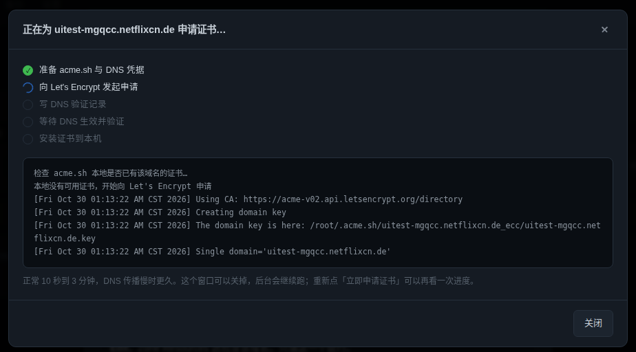
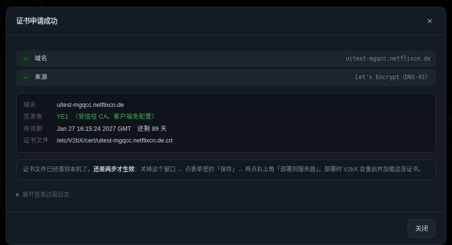

<div align="center">

# v3bx

**V2bX 的 Web 面板版**

装完就有浏览器控制台：加节点、签证书、看日志、回滚配置。
不用再 SSH 上去改 `config.json`。

[一键安装](#一键安装) · [它解决什么](#它解决什么) · [面板能干什么](#核心浏览器里的控制台) · [管理命令](#管理命令)

</div>

---

## 这是什么

[v3bx](https://github.com/Minerchu/v3bx) 是 [wyx2685/V2bX](https://github.com/wyx2685/V2bX) 的分支。

V2bX 是给 **V2board / Xboard** 用的节点服务端：一个进程对接多个节点，管 Vmess / Vless / Trojan / Shadowsocks / Hysteria1&2，负责用户认证、流量统计、在线 IP 和限速。

**v3bx 在它上面做了两件事：**

1. **加了一个 Web 面板** —— 这是主要区别。装完就能在浏览器里改节点、签证书、看日志、回滚配置。
2. **修了内核层几个会导致断流的 bug** —— 详见[面板之外](#面板之外内核层改了什么)。

只想要原版 V2bX？安装时面板那一步回答 `n`，行为跟上游一致，`/etc/V2bX/` 完全兼容，随时可以 `v3bx panel install` 补装。

---

## 它解决什么

V2bX 的内核很稳，麻烦都出在「怎么改它」。下面四个场景都是真实踩过的：

| 场景 | 以前 | 现在 |
|---|---|---|
| **给节点换个端口** | SSH 上去 `vim /etc/V2bX/config.json`，少一个逗号，`systemctl restart` 之后整机节点全掉，还得凭记忆改回去 | 浏览器里改，点「部署」。校验不过不让走，部署失败自动回滚上一份配置 |
| **证书到期 / 想换真证书** | 自己装 acme.sh、装 dnsapi 插件、搞清 `CF_Token` 和 `CLOUDFLARE_DNS_API_TOKEN` 到底谁是谁；签完再手动拷到 `/etc/V2bX/cert/` 重启 | 选「DNS 验证」→ 填 Cloudflare 凭据 → 点「立即申请证书」，五个阶段进度实时刷，签完直接落到目标路径 |
| **hysteria2 改了端口** | 客户端能连上但没网 —— `iptables` 的端口跳跃规则还指着老端口，包全被转到没人监听的地方 | 部署时自动读 `ss -ulnp`，把跳跃规则的目标端口改到实际监听端口并持久化 |
| **对接 Xboard** | NodeID / SNI / 端口三个里错一个就是 401 或超时，没有任何地方能试 | 填 NodeID 点「验证」，真去问一次 Xboard，通不通当场知道，还能把 SNI 和端口自动带出来 |

一句话：**把「改配置」从一件需要小心翼翼的事，变成一件点几下就能完成、改坏了也能自己恢复的事。**

---

## 核心：浏览器里的控制台

零依赖 —— 单个 `panel.py`，只用 Python 3 标准库，systemd 托管，和 V2bX 二进制完全解耦。面板挂了不影响节点，节点重启不用管面板。


| 页面 | 能干什么 |
|---|---|
| **对接** | 填 Xboard 地址 + API Key，声明跑哪几个节点 ID。「测试连接」会真的问一次 Xboard |
| **节点** | 协议、端口、证书、传输层；表单按协议自动适配，`hysteria2` 选不到 `xray`，`socks` / `http` 在 V2bX 下直接禁用 |
| **日志** | 两个服务的日志，错误行自动高亮 |
| **备份** | 每次改动前的配置快照，一键回滚 |

### 部署是一次事务

不是「写完文件就重启」，而是走完整链路：

```
备份 → 生成临时配置 → 语法校验 → 补证书 → 原子替换
     → 重启 → 两次健康检查 → 失败自动回滚 + 回显错误行
```

这是它和「手改 JSON」最本质的区别：**改崩了不会把机器搞挂。**

### 证书：点一下，看得见进度



- **机器上没有 acme.sh？面板自己装。** 下载整包（含 202 个 DNS 插件）、跑官方安装脚本、补上 `dnsapi/` 目录。你不需要登 SSH 敲任何命令。
- **五个阶段逐个点亮**：准备 acme.sh 与 DNS 凭据 → 发起申请 → 写 DNS 验证记录 → 等待生效 → 安装证书。acme.sh 的输出实时滚在下面，卡在哪一步一眼能看出来。
- **签完直接摊开**：签发者、到期时间、剩余天数、证书路径。自签证书会用黄框警告「客户端必须开 `insecure`」—— 这一句话能省掉一半「为什么连不上」的排查。
- **不重复申请**：本地已有可用证书时直接复用，不会去撞 Let's Encrypt 的速率限制（同域名每周 5 张）。



### 端口跳跃自己跟着走

hysteria2 的端口跳跃靠一条 `iptables` 规则把 `50000:51000` 转到真实端口。这条规则不会随端口自动更新 —— 你在面板里把端口从 443 改成 2500，规则还指着 443，表现就是「能连上但没网」。

v3bx 在每次部署后读 `ss -ulnp` 拿到 V2bX 实际监听的 UDP 端口，逐条核对跳跃规则：**只有目标端口确实没人监听时才改**，改完 `netfilter-persistent save`。你自己加的其他 `REDIRECT` 规则不会被碰。

### 先探测，再决定 IPv6

部署前真去探一次本机能不能出网 IPv6。不能就把监听从 `::` 退回 `0.0.0.0`、解析钉死 `ipv4_only`，省掉每条连接先吃一次 `network is unreachable` 再回落的 0.25~1.5 秒。

---

## 一键安装

x86_64 / aarch64 都支持，Debian / Ubuntu / CentOS / Alpine 均可。**用 root 执行**：

```bash
bash <(curl -fsSL -H "Accept: application/vnd.github.raw" \
  "https://api.github.com/repos/Minerchu/v3bx/contents/install.sh?ref=main")
```

> **为什么不用 `raw.githubusercontent.com`**：raw 有 5 分钟 CDN 缓存，刚更新完面板就重装会拿到旧文件。上面这条走 GitHub API，每次都取最新版。

### 它会问你三件事

```
是否安装 Web 管理面板？(Y/n): y
面板端口 [18080]:
面板用户名 [admin]:
面板密码（至少 8 位，留空随机生成）:
```

其余全自动：识别架构、装依赖、下载安装包、校验 SHA256、写 systemd（Alpine 用 openrc）、设开机自启、装好 `v3bx` 命令。

### 装完长这样

```
========================================================
 面板已就绪
--------------------------------------------------------
  地址    : http://1.2.3.4:18080/
  用户名  : admin
  密码    : 你刚设的
========================================================
```

### 然后三步

**1. 放行端口**（十个人里八个卡在这）

```bash
# 有 ufw 的
ufw allow 18080/tcp

# 有 firewalld 的
firewall-cmd --add-port=18080/tcp --permanent && firewall-cmd --reload
```

云服务器还要去控制台的**安全组**里放行同一个端口。这一步在网页上做，命令行管不到。

**2. 浏览器打开面板** → 进「对接」页 → 填 Xboard 地址和 API Key → 点「测试连接」。

**3. 加节点** → 填 NodeID → 点「验证」自动带出 SNI 和端口 → 选证书方式 → 点「部署到服务器」。

> 面板密码只在首次安装时明文写进 `/etc/v2bx-panel/INITIAL_PASSWORD.txt`，在面板里改过就失效。忘了用 `v3bx panel passwd` 重置。

---

## 亮点速览

| | |
|---|---|
| **单文件面板** | 一个 `panel.py`，Python 标准库，无 pip 依赖、无数据库、无 Node |
| **事务式部署** | 备份 → 校验 → 原子替换 → 重启 → 观察 → 失败回滚 |
| **证书一键** | 自动装 acme.sh（含 202 个 DNS 插件）、五阶段进度、自签会明确警告 |
| **端口跳跃自愈** | 部署后自动校正 `iptables` 目标端口 |
| **配置校验** | 协议 / 内核 / 证书组合合法性在部署前就拦掉，不用等重启失败 |
| **凭据池** | DNS 凭据填一次，跨节点复用，写进 `DNSEnv` 供 V2bX 自己续期 |
| **备份与回滚** | 每次改动留快照，出事一键退回去 |

---

## 面板之外：内核层改了什么

这部分和面板无关，是 V2bX 内核本身的修复，参考上游作者新项目 [v2node](https://github.com/wyx2685/v2node)。

| 问题 | 触发场景 | 症状 | 修复 |
|---|---|---|---|
| `compareUserList` 用 `uuid+SpeedLimit` 拼 key | 后台改用户限速 | 该用户全部连接被 `CloseAll` | 按 uuid 比对，限速变化走热更新 |
| `ratelimit.Bucket` 绑死在连接上 | 改限速要生效 | 必须断连重建 | 换 `DynamicBucket`，原地换桶 |
| `LinkManager.CloseAll` 无锁遍历 map | 踢人 / 用户到期 | `fatal error`，**进程直接退出**，同机全节点掉线 | 加锁 + 快照 + 幂等 |
| `Limiter.AliveList` 是普通 map | 定时任务替换 vs 新连接读 | `concurrent map read and write` | 加 `RWMutex` |

第三条最要命：它不是 panic，`recover` 拦不住。一个用户被踢，整台机器的所有节点一起掉线，日志里只留一行 `fatal error`。代码分析见 [docs/STREAM-FIX.md](./docs/STREAM-FIX.md)。

另外两项上游没有的能力：

- **[shadow-tls v3](./SHADOWTLS.md)** —— 面板选插件填参数，自动生成双层入站（外层 shadowtls 回源真实站点，内层 shadowsocks），用户认证、流量统计、在线 IP、限速仍落在原节点上。
- **[节点级出口](./OUTBOUND.md)** —— 每个节点单独选「本地直连」或「SOCKS5」，不再全机共用一个 freedom。

---

## 管理命令

```bash
v3bx              # 管理菜单
v3bx panel        # 面板地址、账号、端口
v3bx panel start|stop|restart|log
v3bx panel port   # 改端口（自动查占用，起不来自动回滚）
v3bx panel passwd # 重置面板密码
v3bx panel install|uninstall

v3bx start|stop|restart|status
v3bx log          # 看日志
v3bx config       # 改配置
v3bx update       # 更新到最新版（旧二进制自动备份，留最近 3 份）
v3bx version
```

`V2bX`、`v2bx`、`v3bx` 三个名字指向同一个脚本，大小写不敏感。

---

## 常见问题

**面板打不开**
先查端口有没有放行：`ufw status` / `firewall-cmd --list-ports`，再去云控制台看安全组。本机自查 `curl -I http://127.0.0.1:18080`，本地通、外面不通就是防火墙。

**证书签不下来**
八成是域名没托管在选的那个 DNS 服务商下（Cloudflare 的域名，NS 必须指向 Cloudflare），或者 API Token 没有该域名的 `Zone.DNS:Edit` 权限。面板会把 acme.sh 的原始输出翻成一句人话，比如「域名解析不到 IP」「API 凭据不对或权限不足」。

**客户端连上了但没网 / 一直握手失败**
先看面板里证书状态：如果是**自签证书**，客户端必须开 `insecure` / `allowInsecure`，不开一定失败。hysteria2 还要确认端口跳跃规则指向的是实际监听端口。

**忘了面板密码**
`v3bx panel passwd`。

**能只装 V2bX 不要面板吗**
能。安装时回答 `n`，之后想装再 `v3bx panel install`。

---

## 从上游或旧版迁过来

配置在 `/etc/V2bX/`，安装器只替换 `/usr/local/V2bX/` 下的二进制，配置原样保留，装完自动重启。

```bash
bash <(curl -fsSL -H "Accept: application/vnd.github.raw" \
  "https://api.github.com/repos/Minerchu/v3bx/contents/install.sh?ref=main")
```

手动替换：

```bash
systemctl stop V2bX
cp /usr/local/V2bX/V2bX /root/V2bX.bak.$(date +%s)
cd /tmp && unzip V2bX-linux-64.zip -d v2bx      # arm 用 V2bX-linux-arm64-v8a.zip
cp v2bx/V2bX /usr/local/V2bX/V2bX && chmod +x /usr/local/V2bX/V2bX
systemctl start V2bX
```

二进制静态编译（`CGO_ENABLED=0`），不挑 glibc 版本。

## 构建

```bash
GOEXPERIMENT=jsonv2 go build -v -o build_assets/V2bX \
  -tags "sing xray hysteria2 with_quic with_grpc with_utls with_wireguard with_acme with_gvisor" \
  -trimpath -ldflags "-X 'github.com/InazumaV/V2bX/cmd.version=$version' -s -w -buildid="
```

两个坑：

- **`GOEXPERIMENT=jsonv2` 必须加**。内核用了 Go 1.25 的 `encoding/json/v2`，不加会报一堆 `package encoding/json/v2 is not in std`。
- **`with_utls`** 已取代旧的 `with_reality_server`，继续用旧标签会 `unknown tag`。

`-tags` 里挑内核：`xray`、`sing`、`hysteria2`，不编的可以不装。

## 文档索引

| 文档 | 内容 |
|---|---|
| [docs/STREAM-FIX.md](./docs/STREAM-FIX.md) | 断流的代码分析、复现步骤、回归测试 |
| [SHADOWTLS.md](./SHADOWTLS.md) | shadow-tls v3 支持说明 |
| [OUTBOUND.md](./OUTBOUND.md) | 节点级出口（direct / SOCKS5） |
| [panel/README.md](./panel/README.md) | 面板实现与接口 |
| [上游文档](https://v2bx.v-50.me/) | 配置文件格式、字段含义（本项目完全兼容） |

## 免责声明

- 本项目面向自用场景，不保证向后兼容。
- 只做服务端软件，不提供任何线路、节点或订阅。使用须遵守你所在地区的法律。
- 出问题请开 Issues，带上完整日志和 `v3bx version` 输出。

## Thanks

* [Project X](https://github.com/XTLS/) · [V2Fly](https://github.com/v2fly) · [sing-box](https://github.com/SagerNet/sing-box)
* [VNet-V2ray](https://github.com/ProxyPanel/VNet-V2ray) · [Air-Universe](https://github.com/crossfw/Air-Universe) · [XrayR](https://github.com/XrayR/XrayR)
* 上游 [wyx2685/V2bX](https://github.com/wyx2685/V2bX)
