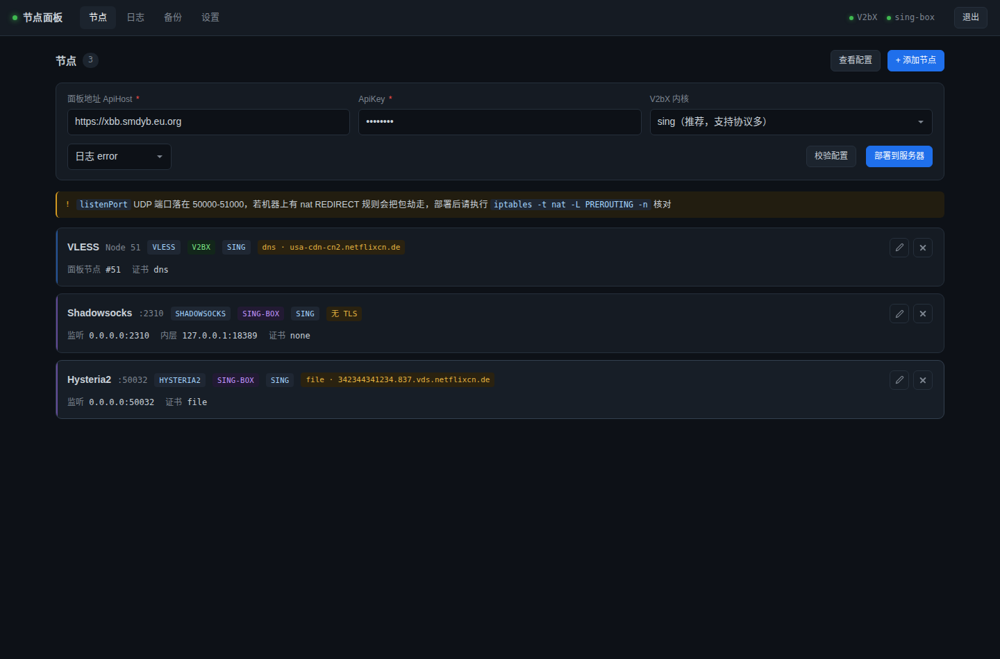
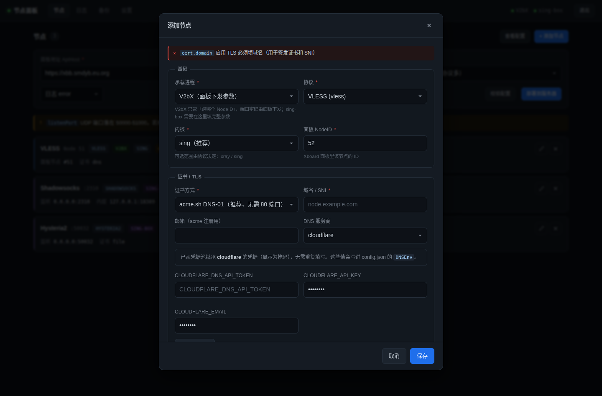

# V2bX 节点管理面板

> 本文件是面板的专题文档（实现细节、接口、字段）。
> 项目整体介绍 —— 它解决什么、亮点、一键安装怎么用 —— 见 [main 分支 README](https://github.com/Minerchu/v3bx/blob/main/README.md)。

给 V2bX / sing-box 节点机用的 Web 管理面板。**不用再 SSH 手写 JSON，浏览器里填表加节点，写错自动拦住，改崩了自动回滚。**

这个面板是 [v3bx](https://github.com/Minerchu/v3bx/blob/main/README.md) 的配套工具，与主程序解耦：只读写 `/etc/V2bX/config.json` 和 `/etc/sing-shadowtls/config.json`，不改 V2bX 二进制、不改服务单元。不用它，V2bX 照常跑；用了它，加节点不用碰命令行。

- 零依赖：只用 Python 3 标准库，不装任何 pip 包
- 单进程：两个文件 + 一个 systemd 单元
- 无损读写：实测生成的 sing-box 配置与现有配置**差异 0 行**（users、tag、detour 全部保留）



| 加节点 | 实时校验 |
|---|---|
|  |  |

---

## 为什么需要它

手改 `/etc/V2bX/config.json` 的典型事故：

| 事故 | 后果 |
|------|------|
| `Cores` 里写了 `{"Type":"hysteria2"}` | `unknown core type` → 服务无限重启 → **该机所有节点一起挂** |
| 端口和另一个进程撞了 | 后启动的那个 bind 失败 → 无限重启 |
| `CertMode: "dns"` 但没填 DNSEnv | 证书签发失败 → TLS 节点全部不可用 |
| JSON 少个逗号 | 服务起不来，日志里只有一行 `unexpected end of JSON input` |

这个面板把每一条都变成了**保存前的拦截**，并且任何一次写入都走完整事务。

---

## 安装

**推荐：直接跑主安装脚本，面板会一起装上。**

```bash
bash <(curl -fsSL -H "Accept: application/vnd.github.raw" \
  "https://api.github.com/repos/Minerchu/v3bx/contents/install.sh?ref=main")
```

> 走 API 直读而不是 `wget raw.githubusercontent.com`：raw 有 5 分钟 CDN 缓存，
> 刚更新完面板就重装会拿到旧文件。这条命令每次都取最新版。

脚本会问面板端口（默认 18080）、用户名、密码，装完把访问地址打给你。之后所有操作都在浏览器里，不用再 SSH。

单独装面板也可以：

```bash
git clone --depth 1 https://github.com/Minerchu/v3bx.git
cd v3bx/panel
bash install.sh
```

`install.sh` 只依赖同目录的 `panel.py` 和 `ui.html`，所以必须在这个目录里执行（不要单独 `curl` 这个脚本）。

交互式会问端口、用户名、密码。也可以非交互：

```bash
PANEL_PORT=18080 PANEL_USER=admin PANEL_PASSWORD='你的密码' bash install.sh
```

安装脚本会自动探测现有的 `/etc/V2bX/config.json` 和 `/etc/sing-shadowtls/config.json`，写入 `/etc/v2bx-panel/panel.env`，并注册 `v2bx-panel.service`。

装完访问 `http://<服务器IP>:<端口>/`。

> **防火墙**：云厂商安全组要放行面板端口；如果机器上有 1Panel / ufw / firewalld，也要单独放行。
> 1Panel 用户可执行：`iptables -I 1PANEL_BASIC 1 -p tcp --dport <端口> -j ACCEPT && netfilter-persistent save`

---

## 它做了什么

### 对接面板也在网页里

第一个页签就是「对接」：填 Xboard 地址和 API Key，列出这台机器要跑哪几个节点 ID，点「保存并重启」就接上了。

「测试连接」会真的拿这组参数去问一次 Xboard 的 `/api/v1/server/UniProxy/config`，返回的端口和协议直接显示出来 —— 密钥填错、节点没分配、地址写错，当场就能看出来，不用等日志。


点「保存并重启」时会**先逐个探测**，探测通了就把 Xboard 下发的 SNI（藏在 `tls_settings.server_name` 里）自动填进节点域名，并按需补一张自签证书。所以新机器从零到能跑，只要在这一页填地址、密钥、NodeID，不需要再去「节点」页手配一遍证书。

端口、密码、协议参数仍然由 Xboard 下发，这里只声明「跑哪几个 NodeID」。证书、监听这些节点级细节在「节点」页。

### 1. 一条一条加节点，字段自动适配

选中协议后，表单会自己变：

- **协议下拉**按承载进程过滤：`socks` / `http` 在 V2bX 下是灰的（它的 NodeType 白名单里没有这两个，写进去会让服务无限重启），只有切到 sing-box 才能选
- **内核下拉框**只列出该协议支持的（`hysteria2` 只给 `sing`，选不到 `xray`）
- **证书区块**自动显示/隐藏（`shadowsocks`/`socks`/`http` 直接跳过；`trojan`/`hy2`/`tuic`/`anytls` 强制必须启用 TLS）
- **证书方式**选 `dns` 才出现 provider 和 API Key 输入框，选 `file` 才出现证书路径
- **协议参数**按类型出现：hy2 给带宽/obfs/伪装站，tuic 给拥塞控制，ss 给加密方式和 shadow-tls 内层端口

### 2. 填的时候就在校验，不用等部署

表单顶部实时显示**当前这个节点**的问题，边填边变。列出的每条都会指明字段名和原因，例如：

```
✕ core      内核 hysteria2 不合法。V2bX 的 Cores[].Type 只认 xray / sing，写其他值会让服务无限重启
✕ listenPort 端口 50032 已被「hysteria2 :50032」占用
! cert.dnsEnv cloudflare 凭据不完整，缺少 CLOUDFLARE_EMAIL；如果用的是 API Token 可忽略
```

### 3. 部署是事务，失败自动回滚

点「部署到服务器」后的完整链路：

```
① 校验（有 error 直接停，配置不动）
② 备份原配置到 /etc/v2bx-panel/backups/
③ 补齐自签证书（缺的现签，过期的重签，已有的不动）
④ 写临时文件
⑤ sing-box check 校验（不通过就停）
⑥ 原子替换（os.replace，不会出现写一半的配置）
⑦ 重启服务
⑧ 等 2 秒看状态 → 再等 4 秒确认没二次崩溃
⑨ 任一步失败 → 自动恢复备份 → 重启 → 把 journalctl 里的错误行提取出来给你看
```

第 ③ 步是为了堵住一个很常见的坑：证书文件不存在时部署，V2bX 起来会因为 TLS 没证书而挂掉，然后回滚，用户看到的就是「保存不了」。现在缺失的证书在写配置之前就补好，一次成功。

第 ⑧ 步是关键：V2bX 崩溃时 `systemctl is-active` 返回的是 `activating` 而不是 `failed`，只查一次会被骗过去。所以要**两次确认**。

失败时的界面会直接给你这样的东西：

```
✕ V2bX 启动          状态 activating
✓ 自动回滚            已恢复到上一个可用配置

V2bX 错误行
2026-10-29T09:15:01 ERROR level=error msg="new core failed" err="unknown core type: hysteria2"
```

### 4. 证书：三条路都通

| 方式 | 谁来做 | 说明 |
|---|---|---|
| **自签** `self` | 面板（openssl） | EC P-256，带 SAN，10 年。点「生成自签证书」立刻出结果；部署时缺了也会自动补。客户端要开 `insecure`/`allowInsecure` |
| **DNS-01** `dns` | 装了 acme.sh 就面板签，没装就 V2bX 签 | V2bX 内置 lego，启动时发现证书文件不存在会自己申请。面板的「立即申请」只是提前把结果给你看 |
| **HTTP-01** `http` | 同上 | 需要 80 端口可达，且域名不能被 CDN 代理（小黄云要关） |
| **已有文件** `file` | 你自己 | 面板只检查存在性和有效期，不碰文件 |

证书状态是实时读出来的（`openssl x509`），界面上直接显示「有效 / 快过期 / 已过期 / 域名不匹配 / 文件不存在」加剩余天数和 CN，域名填错了会当场标红。

**凭据只需填一次**——会存进 `/etc/v2bx-panel/dns-creds.json`（600 权限），之后新建节点自动继承，界面上显示为掩码。掩码不会被当成真凭据发出去，后端会从池子里取真值。

### 5. IPv6：有就用，没有就不碰

没有 IPv6 出口的机器，内核每建一条连接都要先试一次 IPv6、吃一个 `network is unreachable` 再回落 IPv4——单条 0.25~1.5 秒，表现出来就是「能连但很卡」「时断时续」。

面板会在节点页顶部做一次真实探测，不是看有没有地址，而是**真的去连**（Cloudflare / Google / Quad9 的 443，2 秒超时，三个里通一个就算有）：

| 探测结果 | 监听地址 | 域名解析策略 |
|---|---|---|
| 有 IPv6 | `::`（双栈，v4/v6 都收） | `prefer_ipv4` —— v6 可用但排在 v4 后面，避免 v6 路由质量差时反而更慢 |
| 没有 | `0.0.0.0` | `ipv4_only` —— 彻底不解析 AAAA |

监听地址这一步别省：系统禁用 IPv6 模块时 bind `::` 直接 `EAFNOSUPPORT`，节点起不来。

只认全球单播 `2000::/3`。`fe80::` 是链路本地、`fc00::/7` 是 ULA（相当于内网 192.168），都出不了网——有些机器只挂了个 `fd00:dead:beef::1`，看着像「有 v6」其实没有。

结果缓存 5 分钟，可以点「重测」强制刷新，也可以手动切成强制开/强制关。

落到配置上是三处：

- `config.json` → 节点 `ListenIP`
- `config.json` → `XrayOptions.DNSType`（xray 内核；`UseIPv4` 只在 `EnableDNS: true` 时生效）
- `/etc/V2bX/sing_origin.json` → `outbounds[direct].domain_strategy` 与 `dns.servers[].strategy`（sing 内核真正读这个文件）

顺带补了个坑：这个文件以前没人创建，而 `config.json` 的 `Cores[].OriginalPath` 指着它，**新机首装必挂**（`read original config error`）。现在安装脚本会生成，面板部署时也会兜底补齐。

### 6. 日志和备份

- **日志页**：直接看 `journalctl -u V2bX` / `sing-shadowtls`，自动高亮错误行，顶部汇总「发现 N 条错误，最新一条：xxx」
- **备份页**：列历史备份，可一键回滚到任意版本（回滚前会再备份当前配置）

---

## 关键设计

### V2bX 节点 vs sing-box 节点

面板把两者统一成一个「节点」列表，但生成逻辑完全不同：

| | V2bX 节点 | sing-box 节点 |
|---|---|---|
| 配置内容 | 只有 `NodeID`/`NodeType`/`Core`/`CertConfig` | 完整 inbound（端口、密码、TLS、obfs…） |
| 端口谁定 | **面板下发**，所以表单里不填 | 自己填 |
| 用户列表 | V2bX 自己拉 | 由同步脚本维护，**面板不碰** |

> 这一点很重要：sing-box 的 `users` 是同步脚本（cron）维护的 171 个用户，面板重新生成配置时会**原样保留**，不会清空。

### shadowtls 一张卡片 = 两个 inbound

选 `shadowsocks` + 填「shadow-tls 内层端口」，会自动生成串联的两个 inbound：

```json
{"type":"shadowtls","tag":"stls-in","listen_port":2310,
 "handshake":{"server":"www.php.net","detour":"hs-direct"},
 "detour":"ss-in"},
{"type":"shadowsocks","tag":"ss-in","listen":"127.0.0.1","listen_port":18389,
 "method":"2022-blake3-aes-256-gcm","users":[171个]}
```

- 外层对公网，内层只绑 `127.0.0.1`
- `detour` 自动配对，不用手写 tag
- `handshake.detour` 会**保留原值**（比如 `hs-direct` 那个带 `domain_strategy: ipv4_only` 的 outbound），不会退化成默认的 `direct`

### 为什么不做二进制协议检测

一开始我尝试用 `strings V2bX | grep hysteria2` 判断二进制是否支持某协议。**这个方法是错的**：

- 77MB 的 Go 二进制里 `grep -ac hysteria2` 返回 **69** 处匹配
- 但 V2bX v1.1.0 实际并不支持 hy2 core

残留字符串会骗人。所以面板不做静态判定，改成：**部署时真跑一遍，失败自动回滚**。这比任何静态分析都准。

真正该拦的是 `Cores[].Type` 只能是 `xray` / `sing` —— 这个已经硬校验了。

---

## 安全建议

面板默认 `0.0.0.0` 监听 + HTTP 明文，**公网裸奔有风险**。三种加固方式，按推荐排序：

**① SSH 隧道（最省事，推荐）**

```bash
# 面板改成只监听本地
sed -i 's/PANEL_BIND=.*/PANEL_BIND=127.0.0.1/' /etc/v2bx-panel/panel.env
systemctl restart v2bx-panel

# 本地电脑执行（之后浏览器开 http://127.0.0.1:18080）
ssh -N -L 18080:127.0.0.1:18080 root@<服务器IP>
```

**② Nginx 反代 + HTTPS + IP 白名单**

```nginx
location / {
    allow 1.2.3.4;      # 你的固定 IP
    deny all;
    proxy_pass http://127.0.0.1:18080;
}
```

**③ 至少限制来源 IP**

```bash
iptables -I 1PANEL_BASIC 1 -p tcp --dport 18080 -s 1.2.3.4 -j ACCEPT
iptables -I 1PANEL_BASIC 2 -p tcp --dport 18080 -j DROP
netfilter-persistent save
```

面板本身有的防护：密码 PBKDF2-SHA256（20 万轮）、登录失败 10 次锁 5 分钟、会话 12 小时过期、敏感字段脱敏回传。

---

## 常用命令

```bash
systemctl status v2bx-panel
journalctl -u v2bx-panel -f
systemctl restart v2bx-panel

# 改端口/密码（改完重启生效）
vi /etc/v2bx-panel/panel.env

# 忘记密码：删掉认证文件，重启后会重新生成
rm /etc/v2bx-panel/auth.json && systemctl restart v2bx-panel
cat /etc/v2bx-panel/INITIAL_PASSWORD.txt
```

## 文件位置

| 路径 | 内容 |
|------|------|
| `/opt/v2bx-panel/panel.py` | 主程序 |
| `/opt/v2bx-panel/ui.html` | 前端界面 |
| `/etc/v2bx-panel/panel.env` | 端口、账号配置 |
| `/etc/v2bx-panel/auth.json` | 密码哈希（600） |
| `/etc/v2bx-panel/dns-creds.json` | DNS 服务商凭据池（600） |
| `/etc/v2bx-panel/ipv6.json` | IPv6 策略（auto / on / off） |
| `/etc/v2bx-panel/backups/` | 配置备份，保留 30 天 |

## 卸载

```bash
systemctl disable --now v2bx-panel
rm -rf /opt/v2bx-panel /etc/v2bx-panel
rm /etc/systemd/system/v2bx-panel.service
systemctl daemon-reload
```

面板不会修改 V2bX / sing-box 的服务单元，卸载后节点服务照常运行。

---

## 已知限制

- **V2bX 的端口、path、密码由 Xboard 面板下发**，本面板只管「跑哪些 NodeID」。想改这些还得在 Xboard 里改。
- **Xboard 里新增节点后，仍需在本面板加一条**（因为老版本 Xboard 没有 `/api/v2/server/machine/nodes` 自动发现接口）。但至少不用再手写 JSON 了。
- **面板不管理 sing-box 的 users**，那是同步脚本的事，面板只保证重新生成配置时不破坏它。
- **`socks` / `http` 只能给独立 sing-box 实例用**。V2bX 的 `NewClient` 有硬编码白名单（`api/panel/panel.go:59`），塞进去会 `unsupported Node type` 然后无限重启，所以面板在 V2bX 节点下把这两项禁掉了。
- **续期分工**：`dns`/`http` 由 V2bX 的 `renewCertTask` 每天检查并续；`self` 由面板在部署时检查，过期或域名变了就重签；`file` 面板完全不碰。
- **面板不校验 Xboard 那边的 TLS 开关**。Xboard 节点没开 TLS 但你在面板配了证书，不会报错，只是白配；反过来 Xboard 开了 TLS 而面板选「不启用」，节点会以明文监听，客户端连不上。部署后看日志里有没有 TLS 相关报错最直接。

---

## 更新面板

```bash
cd v3bx && git pull
bash panel/install.sh          # 重跑安装即覆盖 /opt/v2bx-panel 下的程序
```

配置和备份都在 `/etc/v2bx-panel/`，重装不会动。

## License

本目录代码随主仓库一同以 [MPL-2.0](./LICENSE) 发布。
