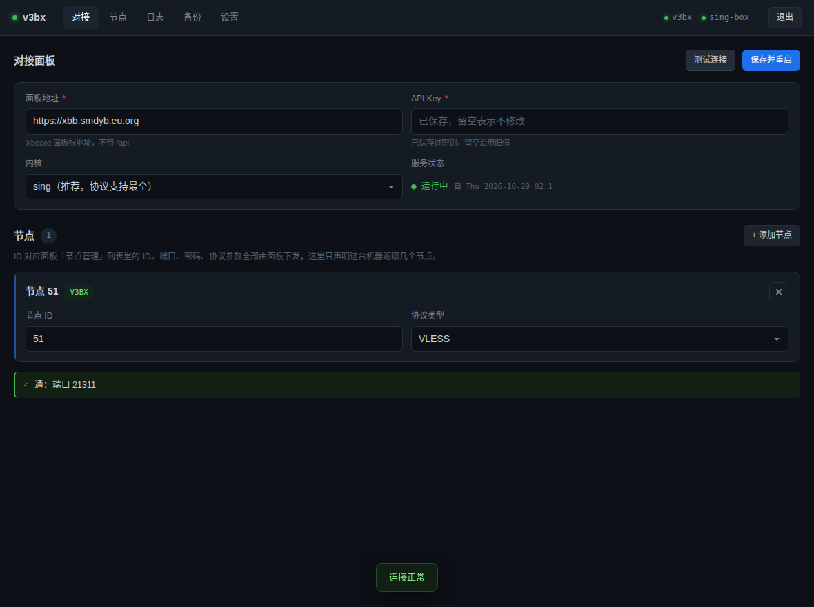

# V2bX 稳定分支

**给 V2board / Xboard 用的节点服务端**，管 Vmess / Vless / Trojan / Shadowsocks / Hysteria1&2，一个进程对接多个节点。

这是 [wyx2685/V2bX](https://github.com/wyx2685/V2bX) 的分支。上游能跑，但跑到几十个用户、几百个连接之后会暴露几处硬伤——**改个限速全员掉线、踢一个人整个进程 fatal error 退出、加节点要 SSH 手改 JSON**。本分支就做四件事，全部围绕这些：

| # | 症状 | 一句话修复 | 细节 |
|---|---|---|---|
| 1 | 后台改一个用户的限速，他的连接全被掐断 | 限速比对从「uuid+限速」改成只认 uuid，限速变化走热更新 | [断流修复](#1-断流修复) · [docs/STREAM-FIX.md](./docs/STREAM-FIX.md) |
| 2 | 踢人 / 用户到期，日志一行 `fatal error`，**同机所有节点一起掉线** | `CloseAll` 无锁遍历 map 是根因，加锁 + 快照 + 幂等 | [断流修复](#1-断流修复) |
| 3 | 加节点要 SSH 进机器改 `config.json`，错一个字整机起不来 | 装完即带 Web 面板，浏览器填表，改崩自动回滚 | [Web 面板](#2-web-面板) · [panel/](./panel/) |
| 4 | ShadowSocks 想加 shadow-tls v3，得自己拼双层入站 | 面板选插件填参数，自动生成双层入站，计费心跳照旧 | [shadow-tls](#3-shadow-tls-v3) · [SHADOWTLS.md](./SHADOWTLS.md) |

外加上游根本没有的能力：**每个节点单独选出口**（本地直连 / SOCKS5），不用再在「全机一个出口」和「手动改代码」之间二选一 · [OUTBOUND.md](./OUTBOUND.md)

安装方式、配置格式、管理命令与上游一致，替换二进制即可，`/etc/V2bX/` 原样保留。

## 一键安装

```bash
bash <(curl -fsSL -H "Accept: application/vnd.github.raw" \
  "https://api.github.com/repos/Minerchu/v3bx/contents/install.sh?ref=main")
```

> 用 API 直读而不是 `wget raw.githubusercontent.com`：raw 有 5 分钟 CDN 缓存，
> 刚更新完面板就重装会拿到旧文件。这条命令每次都取最新版。

脚本自动识别架构（x86_64 / aarch64）、装依赖、下载安装包、校验 SHA256、写 systemd（Alpine 用 openrc）、设开机自启，最后装好 `V2bX` 命令（`v2bx`、`v3bx` 是它的软链，随便用哪个）。

装完会问三件事——面板端口、用户名、密码——然后直接把面板地址和账号打给你：

```
========================================================
 面板已就绪
--------------------------------------------------------
  地址    : http://1.2.3.4:18080/
  用户名  : admin
  密码    : 你刚设的
========================================================
```

后续升级走 `v3bx update`，旧二进制自动备份到 `/usr/local/V2bX-backup/`（留最近 3 份），起不来直接换回去。

<details>
<summary>全部管理命令</summary>

```bash
v3bx              # 管理菜单
v3bx start|stop|restart|status
v3bx log          # 看日志
v3bx config       # 改配置
v3bx update[ 版本号]
v3bx install|uninstall
v3bx version
v3bx generate     # 重新生成配置文件
v3bx x25519       # 生成 x25519 密钥
v3bx panel ...
```

`V2bX`、`v2bx`、`v3bx` 三个名字指向同一个脚本，用哪个都行。

</details>

---

## 1. 断流修复

「用着用着就断，过一会儿又好了」——服务端侧有四个明确根因，本分支全修了。修复思路参考上游作者新项目 [v2node](https://github.com/wyx2685/v2node)。

| 问题 | 触发场景 | 症状 | 修复 |
|---|---|---|---|
| `compareUserList` 用 `uuid+SpeedLimit` 拼 key | 后台改用户限速 | 该用户全部连接被 `CloseAll` | 按 uuid 比对，限速变化走 `modified` 热更新 |
| `ratelimit.Bucket` 绑死在连接上 | 改限速要生效 | 必须断连重建 | 换 `DynamicBucket`（`atomic.Value`），原地换桶 |
| `LinkManager.CloseAll` 无锁遍历 map | 踢人 / 用户到期 | `fatal error`，**进程直接退出**，同机全节点掉线 | 加锁 + 快照 + `closed` 幂等 |
| `Limiter.AliveList` 是普通 map | 定时任务替换 vs 新连接读 | `concurrent map read and write` | 加 `RWMutex`，统一走 setter |

第三条最要命：它不是 panic，`recover` 拦不住，一个用户被踢会让整台机器的所有节点一起掉线，日志里只留一行 `fatal error`。

> 这里修的是**服务端进程内**的断流。如果你遇到的是「用几分钟就卡住、换个 IP 又好了」，那是客户端到入口的链路问题，跟代码无关，得靠优选 IP 或换入口解决。

## 2. Web 面板

零依赖（Python 3 标准库）、单进程、systemd 托管，和二进制完全解耦。



| 页面 | 干什么 |
|---|---|
| **对接** | 填 Xboard 地址 + API Key，声明跑哪几个节点 ID。「测试连接」会真的问一次 Xboard，通不通当场知道 |
| **节点** | 证书、监听、协议细节；表单按协议自动适配字段，`hysteria2` 选不到 `xray`，`socks`/`http` 在 V2bX 下直接禁用 |
| **日志** | 两个服务的日志，错误行自动高亮 |
| **备份** | 每次改动前的配置快照，一键回滚 |

三件事值得单独说：

- **部署是事务**：备份 → 校验 → 补证书 → 原子替换 → 重启 → 两次确认 → 失败自动回滚并回显错误行。改崩了不会把机器搞挂。
- **证书三条路**：自签（openssl 生成）、DNS/HTTP-01（acme.sh 或内置 lego）、已有文件。界面直接显示剩余天数、CN，域名填错标红。
- **IPv6 先探测再决定**：部署前真去探一次本机能不能出网 IPv6，不能就把监听从 `::` 退回 `0.0.0.0`、解析钉死 `ipv4_only`，省掉每条连接先吃一次 `network is unreachable` 再回落的 0.25~1.5 秒。

```bash
v3bx panel            # 面板地址、账号、端口
v3bx panel start|stop|restart|log
v3bx panel port       # 改端口（自动查占用，起不来自动回滚）
v3bx panel passwd     # 重置密码
v3bx panel uninstall
```

菜单里也有：`v3bx` → **17**。不想装面板？安装时回答 `n`，之后 `v3bx panel install` 补装。

> 密码只在首次安装时明文写进 `/etc/v2bx-panel/INITIAL_PASSWORD.txt`，在面板里改过就过期，用 `v3bx panel passwd` 重置。

## 3. shadow-tls v3

上游会把面板下发的 `plugin` / `plugin_opts` 丢弃，只能跑裸 SS。这里补上了：

面板建 shadowsocks 节点 → 插件选 `shadow-tls` → 参数 `host=...;password=...;version=3`，自动生成两个嵌套入站：

```
公网 0.0.0.0:2310          shadowtls  ← TLS 回源 host 指定的真实站点
   │  detour（进程内直接转交）
   ▼
127.0.0.1:12310            shadowsocks  ← 多用户、计流量、报心跳
```

外层端口就是面板的 `server_port`，内层自动挑一个 `server_port + 10000` 附近的空闲回环端口。因为走 `Detour`，**用户认证、流量统计、在线 IP、限速全部仍然落在原节点 tag 上**，和普通 SS 节点行为一致。

被动探测看到的就是一个标准 HTTPS 服务，SNI 和证书来自 `host` 指向的真实站点。内核（`wyx2685/sing-box_mod`，sing-box 1.13 系）自带 shadow-tls 入站，不需要额外进程或配置项。完整说明见 [SHADOWTLS.md](./SHADOWTLS.md)。

## 4. 节点级出口

上游的出口是**全机一个 freedom**，所有节点跑完路由都落到同一个默认出站。现在每个节点能单独选：

- **本地直连** = 原行为，不产生额外出站
- **SOCKS5** = 这个节点的流量从这个 socks5 出去，可带账号密码，其它节点不受影响

xray 靠「出站 tag 与入站同名 + dispatcher 兜底」，sing 靠写进 `sing_origin.json` 的路由规则，两种内核都支持。节点配置里多一个**可选**字段 `OutboundConfig`，不填就是直连，老配置照用。细节见 [OUTBOUND.md](./OUTBOUND.md)。

---

## 能力清单

- Vmess / Vless / Trojan / Shadowsocks / Hysteria1&2，单实例多节点
- 多内核（xray / sing-box / hysteria2），条件编译，只编要用的
- 在线 IP 限制、TCP 连接数限制、节点级 / 用户级限速、动态限速
- 自定义 DNS、审计规则、在线人数统计、证书自动申请续签
- MPL-2.0，可商用可改

## 从上游或官方版迁过来

```bash
bash <(curl -fsSL -H "Accept: application/vnd.github.raw" \
  "https://api.github.com/repos/Minerchu/v3bx/contents/install.sh?ref=main")
```

> 用 API 直读而不是 `wget raw.githubusercontent.com`：raw 有 5 分钟 CDN 缓存，
> 刚更新完面板就重装会拿到旧文件。这条命令每次都取最新版。

配置在 `/etc/V2bX/`，安装器只替换 `/usr/local/V2bX/` 下的二进制，配置原样保留，装完自动重启。手动替换：

```bash
systemctl stop V2bX
cp /usr/local/V2bX/V2bX /root/V2bX.bak.$(date +%s)
cd /tmp && unzip V2bX-linux-64.zip -d v2bx      # arm 用 V2bX-linux-arm64-v8a.zip
cp v2bx/V2bX /usr/local/V2bX/V2bX && chmod +x /usr/local/V2bX/V2bX
systemctl start V2bX
```

二进制静态编译（`CGO_ENABLED=0`），不挑 glibc 版本。

## 构建

```bash
GOEXPERIMENT=jsonv2 go build -v -o build_assets/V2bX \
  -tags "sing xray hysteria2 with_quic with_grpc with_utls with_wireguard with_acme with_gvisor" \
  -trimpath -ldflags "-X 'github.com/InazumaV/V2bX/cmd.version=$version' -s -w -buildid="
```

两个坑：

- **`GOEXPERIMENT=jsonv2` 必须加**。内核用了 Go 1.25 的 `encoding/json/v2`，不加会报一堆 `package encoding/json/v2 is not in std`。
- **`with_utls`** 已经取代旧的 `with_reality_server`，继续用旧标签会 `unknown tag`。

`-tags` 里挑内核，可选 `xray`、`sing`、`hysteria2`，不编的能不装。

## 文档索引

| 文档 | 内容 |
|---|---|
| [docs/STREAM-FIX.md](./docs/STREAM-FIX.md) | 断流的代码分析、复现步骤、回归测试 |
| [SHADOWTLS.md](./SHADOWTLS.md) | shadow-tls v3 支持说明 |
| [OUTBOUND.md](./OUTBOUND.md) | 节点级出口（direct / SOCKS5） |
| [panel/README.md](./panel/README.md) | 面板实现与接口 |
| [上游文档](https://v2bx.v-50.me/) | 配置文件格式、字段含义（本项目完全兼容） |

## 免责声明

- 本项目面向自用场景，不保证向后兼容。
- 只做服务端软件，不提供任何线路、节点或订阅。使用须遵守你所在地区的法律。
- 出问题请开 Issues，带上完整日志和 `v3bx version` 输出。

## Thanks

* [Project X](https://github.com/XTLS/) · [V2Fly](https://github.com/v2fly) · [sing-box](https://github.com/SagerNet/sing-box)
* [VNet-V2ray](https://github.com/ProxyPanel/VNet-V2ray) · [Air-Universe](https://github.com/crossfw/Air-Universe) · [XrayR](https://github.com/XrayR/XrayR)
* 上游 [wyx2685/V2bX](https://github.com/wyx2685/V2bX)
